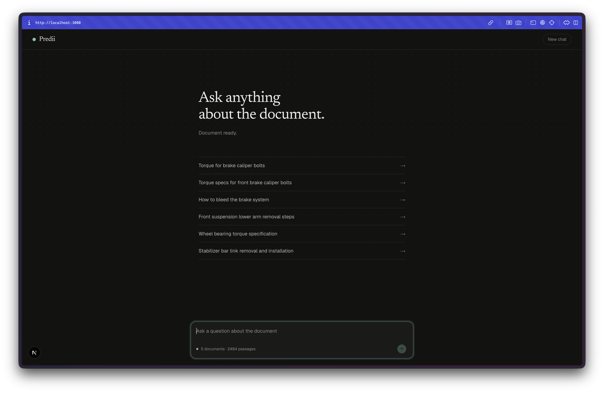
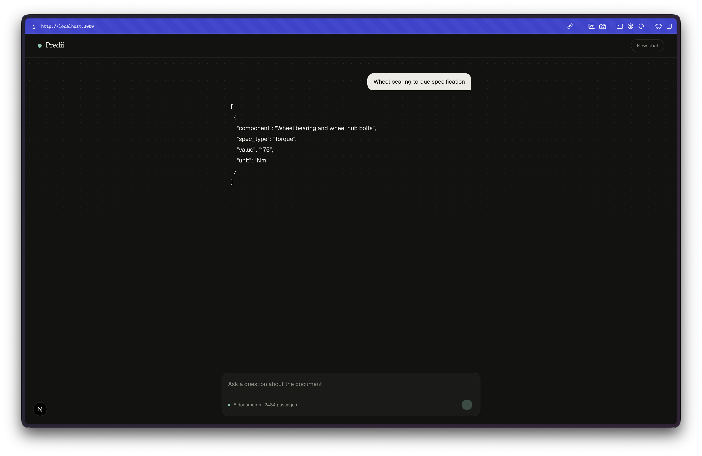

# Predii

Predii is a document question-answering chat application built with **Next.js 16**, **React 19**, and **TypeScript**. It lets you chat with vehicle repair documentation (markdown converted from PDFs) using a local RAG (Retrieval-Augmented Generation) pipeline and the NVIDIA Nemotron-3.5-Super model.

## Features

- **Chat interface** — streaming assistant responses, message history, "New chat", jump-to-bottom, and question starters.
- **Local vector index** — markdown files are chunked by heading, embedded with `BAAI/bge-base-en-v1.5`, and stored in a persistent ChromaDB on disk.
- **Incremental indexing** — the index is rebuilt only when source files or chunking settings change (signature-based change detection).
- **Spec extraction** — answers are returned as a validated JSON array of `{ component, spec_type, value, unit }` rows, never empty.
- **Dark/light mode** — system-preference aware with a custom paper/ink/accent palette.

## Screenshots

### Document Chat Interface & Question Starters


### Vehicle Specification Extraction (JSON Output)


## System architecture

```
┌─────────────────────────────────────────────────────────────────┐
│                     Browser (Next.js client)                    │
│  app/page.tsx  ·  chat UI, streaming SSE-like ReadableStream   │
└──────────────────┬──────────────────────────────────────────────┘
                   │ HTTP POST /api/chat  (streaming, abortable)
                   ▼
┌─────────────────────────────────────────────────────────────────┐
│                 Next.js API Route  app/api/chat/route.ts        │
│  • GET  : warm-up / status (loads or builds the index)          │
│  • POST : retrieve → build context → call LLM → validate JSON   │
└──────────────────┬──────────────────────────────────────────────┘
                   │ fetch to embedding server
                   ▼
┌─────────────────────────────────────────────────────────────────┐
│           Python embedding server  embed_server.py (FastAPI)    │
│  GET  /health     model + embedding dimension                   │
│  GET  /status     index signature + chunk count                 │
│  POST /index      add/replace chunks in Chroma                  │
│  POST /search     cosine-similarity top-k retrieval             │
└──────────────────┬──────────────────────────────────────────────┘
                   │ ChromaDB (persistent, on disk in ./chroma_db)
                   ▼
┌─────────────────────────────────────────────────────────────────┐
│                 Vector store  ChromaDB (collection: predii)     │
│  Embedding model: BAAI/bge-base-en-v1.5  (sentence-transformers)│
└──────────────────┬──────────────────────────────────────────────┘
                   │ OpenAI-compatible chat/completions
                   ▼
┌─────────────────────────────────────────────────────────────────┐
│              LLM  NVIDIA Nemotron-3.5-Super (build.nvidia.com)  │
│  SYSTEM_PROMPT forces a JSON array of spec rows                 │
└─────────────────────────────────────────────────────────────────┘
```

### Data flow (one question)

1. Client sends the conversation history to `POST /api/chat`.
2. The route loads/builds the local index (`lib/rag.ts`), then searches Chroma for the top-6 most relevant chunks.
3. Retrieved chunks are turned into a numbered `<context>` block (`lib/format.ts`).
4. System prompt + history + context are sent to the NVIDIA Nemotron API.
5. The model replies with a JSON array of spec rows; the route validates and falls back to a "Not found in document" row if parsing fails.
6. The client streams the rendered answer into the chat.

## Project structure

```
predii/
├── app/
│   ├── layout.tsx          # Root layout, fonts (Geist, Newsreader), metadata
│   ├── page.tsx            # Client chat UI (messages, composer, starters)
│   ├── globals.css         # Tailwind v4, custom tokens, animations
│   └── api/chat/route.ts   # Chat API: warm-up, retrieval, LLM call, validation
├── lib/
│   ├── rag.ts              # Markdown chunking, index build/load, search client
│   └── format.ts           # SYSTEM_PROMPT, answer schema, context builder
├── embed_server.py         # FastAPI + sentence-transformers + ChromaDB server
├── pdf/                    # Source markdown documents (.md converted from PDFs)
├── chroma_db/              # Persistent vector database (created at runtime)
├── .env                    # NVIDIA_API_KEY, NVIDIA_MODEL (not committed)
├── package.json            # Next.js 16, React 19, TypeScript, Tailwind v4
├── next.config.ts
├── tsconfig.json
└── eslint.config.mjs
```

## Prerequisites

- Node.js 20+
- Python 3.10+ with `pip`
- An [NVIDIA build.nvidia.com](https://build.nvidia.com) API key

## Python embedding server (required)

The chat app depends on a local embedding server. From the project root:

```bash
# create/activate a venv (example)
python -m venv .venv
source .venv/bin/activate

pip install sentence-transformers chromadb fastapi uvicorn

# run the server (default port 8001)
uvicorn embed_server:app --port 8001
```

Endpoints: `GET /health`, `GET /status`, `POST /index`, `POST /search`.
Vectors are persisted on disk in `./chroma_db` and survive restarts.

## Frontend

```bash
npm install        # or yarn / pnpm / bun
npm run dev        # http://localhost:3000
npm run build
npm run start
npm run lint
```

## Configuration

Create a `.env.local` (or add to `.env`, which is gitignored) at the project root:

```
NVIDIA_API_KEY=your-nvidia-api-key
NVIDIA_MODEL=nvidia/nemotron-3.5-super-vl-120b-a12b
EMBED_SERVER=http://127.0.0.1:8001   # optional, defaults to localhost:8001
```

Drop your markdown documents into `pdf/` (e.g. `*.md`). The index rebuilds automatically on the first request after files change.

## Example questions

- Torque for brake caliper bolts
- How to bleed the brake system
- Front suspension lower arm removal steps
- Wheel bearing torque specification
- Stabilizer bar link removal and installation

## Design

### Visual design
- **Paper/ink palette** — a custom light/dark theme (`--paper`, `--surface`, `--ink`, `--muted`, `--line`, `--accent`) defined in `app/globals.css`, with system color-scheme detection.
- **Typography** — Geist Sans/Mono for UI and code, Newsreader (serif) for headings and long-form answers, loaded via `next/font/google` with self-hosted fallback.
- **Layout** — single-column chat with a sticky header, fixed composer footer, scrollable message area, and a "jump to bottom" floating button that appears when the user scrolls up.
- **Animations** — pure CSS keyframes (`fade-up`, `fade-in`, `pop-in`, `blink`, `dot`) with `prefers-reduced-motion` support that disables all motion.

### Interaction design
- **Streaming answers** — the assistant message is rendered incrementally as the ReadableStream chunks arrive, with a typing indicator (animated dots) and a blinking cursor while text is present.
- **Abortable requests** — an `AbortController` lets users stop generation mid-stream; the signal is forwarded to the NVIDIA upstream call.
- **Auto-resizing textarea** — grows with content up to 200px, Shift+Enter for newlines, Enter to send.
- **KB state badge** — a colored dot in the composer shows indexing status: pulsing (loading), green (ready), red (error).
- **Question starters** — suggested queries on empty state to lower the barrier to first use.

### Component structure (`app/page.tsx`)
- `Home` — chat state, message list, composer, KB warm-up.
- `Entry` — individual user/assistant message bubble with typing states.

## Tools used

| Category | Tool | Purpose |
|----------|------|---------|
| Framework | Next.js 16 (App Router) | Full-stack React framework, API routes, server components |
| UI library | React 19 | Client-side chat interface |
| Language | TypeScript | Type safety across frontend and shared lib code |
| Styling | Tailwind CSS v4 | Utility-first styling with CSS variables / theme |
| Fonts | Geist, Geist Mono, Newsreader (via `next/font`) | Self-hosted web fonts |
| Embeddings | sentence-transformers (`BAAI/bge-base-en-v1.5`) | Dense vector encoding of text chunks |
| Vector database | ChromaDB (persistent) | Local cosine-similarity vector search |
| Embedding server | FastAPI + uvicorn | Python HTTP service wrapping Chroma + the embedding model |
| LLM | NVIDIA Nemotron-3.5-Super (`build.nvidia.com`) | Spec extraction via OpenAI-compatible chat/completions API |
| Package manager | npm | Dependency management |
| Linting | ESLint + `eslint-config-next` | Code quality checks |
| Documents | Markdown (`pdf/`) | Source repair manuals converted from PDF |

## Ideas for improvement

- **Streaming LLM responses** — switch from `stream: false` to true and stream tokens to the client for lower perceived latency.
- **Citations in answers** — render retrieved chunk numbers inline so users can verify each spec against the source passage.
- **Conversation history** — persist chats to localStorage or a backend so history survives reloads.
- **File upload** — let users upload their own PDFs/markdown instead of only pre-placed files in `pdf/`.
- **Hybrid search** — combine vector search with BM25/keyword search for better recall on exact part numbers.
- **Re-ranking** — add a cross-encoder re-ranker on top of the top-k vector results.
- **Multi-document filtering** — scope searches to specific documents or sections via metadata filters.
- **Units normalization** — convert units (e.g. ft-lb ↔ Nm) and present both in the answer.
- **Evaluation harness** — build a Q&A benchmark with expected spec rows to measure answer accuracy over time.
- **Docker** — containerize the FastAPI embedding server and Next.js app for one-command deployment.
- **Accessibility** — add ARIA live regions for streaming text, keyboard navigation audit, and focus trapping.

## License

MIT